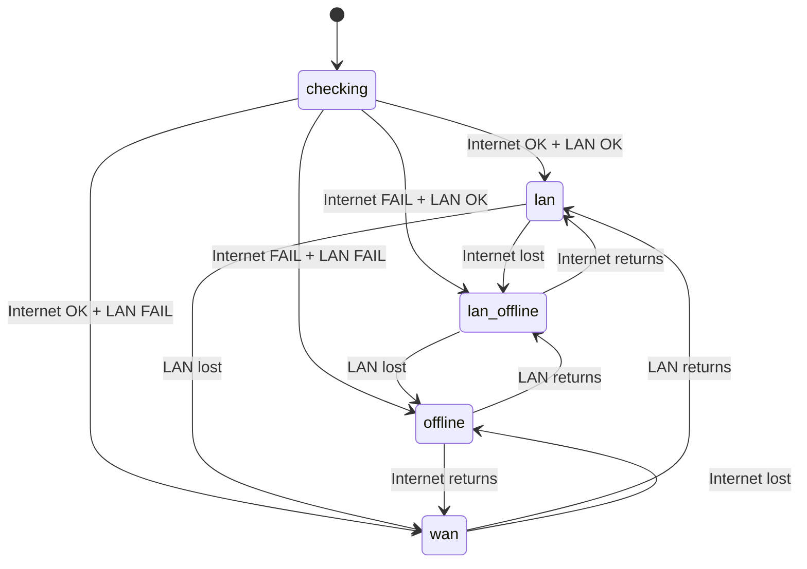
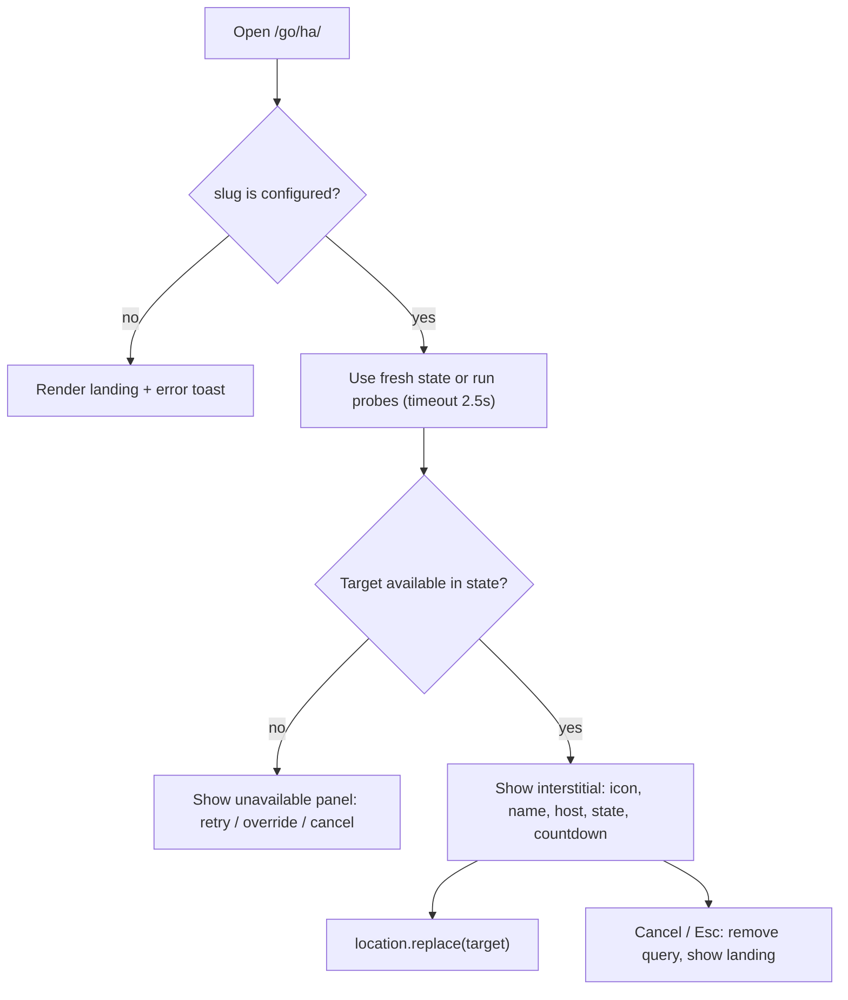

# Landing — Specification

Status: **Draft (v0.2, local-first pivot)**  
Version: 0.2  
Date: 2026-11-06  
Implementation: Rust binary (`src/`), embedded frontend (`src/js`, `src/styles`, `src/templates`), `config/landing.example.yml`, `tests/`; build and install with `landing` (the binary).  

> **Direction change (v0.2).** Landing is no longer a cloud-built, cloud-installed, or extension-based product. It is a **local-first** application: the user clones the repository, edits it, and runs a single entrypoint script that builds the site, installs it on the local machine following Linux conventions, starts it on `localhost`, and verifies it with a healthcheck. There is no CDN, no hosted build, no browser extension, and no userscript. The recommended adoption path is **fork → clone → edit → ship locally**.

---

## Contents

1. [Summary](#1-summary)
2. [Goals and non-goals](#2-goals-and-non-goals)
3. [Terminology](#3-terminology)
4. [Requirements](#4-requirements)
5. [Architecture](#5-architecture)
6. [Configuration schema](#6-configuration-schema)
7. [Runtime behavior in detail](#7-runtime-behavior-in-detail)
8. [Security and privacy](#8-security-and-privacy)
9. [Testing and verification](#9-testing-and-verification)
10. [Local installation and operations](#10-local-installation-and-operations)
11. [Implementation plan](#11-implementation-plan)
12. [Open questions and risks](#12-open-questions-and-risks)
13. [Acceptance criteria](#13-acceptance-criteria-definition-of-done)
14. [References](#14-references)

---

## 1. Summary

Landing is a personal homelab start page that runs on the user's own computer. It presents a curated, grouped, well-designed list of links ("favorites") configured in YAML, built locally, installed locally, and served on `localhost`. At runtime, a small amount of browser JavaScript determines:

1. whether the browser currently has Internet access, and
2. whether the browser is on the home LAN and can resolve local DNS names.

It then chooses the correct URL for each favorite:

- on the home LAN → the LAN URL (for example `http://ha.lan/`),
- away from home → the public URL (for example `https://ha.example.com/`),
- offline but on the home LAN → the LAN URL, because it is the only URL that can work,
- offline and not on the home LAN → no external link can work; show an offline state.

The same build also supports a "live redirect" mode: a bookmark or favorites-bar link such as

```text
http://localhost:8080/go/ha/
```

loads Landing, resolves the current network state, shows a short interstitial, and then navigates to the correct URL for Home Assistant. Only links defined in the YAML configuration can be resolved; the query string is never an open redirect. Because the build runs locally, it can also fetch each service's real favicon at build time, so `/go/` bookmarks and cards show the actual service icon by default.

The design philosophy follows [gethomepage.dev](https://gethomepage.dev/): YAML configuration, clean card-based groups, icons, search, light/dark themes, responsive layout, and no unnecessary runtime complexity. Unlike Homepage, Landing has **no server-side widgets and no API proxying**; the only local process is a small static file server with a healthcheck.

### 1.1 Local-first adoption model

The supported and recommended way to use Landing is:

1. **Fork** the repository (or use it directly).
2. **Clone** it to the machine that will serve it.
3. **Edit** `config/landing.yml` and local assets.
4. **Run the entrypoint** (`./landing` or `./landing install`), which:
   - builds the updated landing page locally,
   - installs it locally following Linux conventions (XDG data/config paths, a systemd user unit, or a documented fallback),
   - starts the service on `localhost`,
   - runs a healthcheck and reports success or a clear failure.

There is no cloud build, no cloud install, no CDN, no hosted dependency, and no browser extension. Anyone can fork, clone, edit, and ship without any external service.

---

## 2. Goals and non-goals

### 2.1 Goals

- **Local-first.** The build, install, and runtime all happen on the user's computer. The site is served from `localhost`; there is no cloud build, cloud install, CDN, or hosted dependency.
- **Fork → clone → edit → ship.** The repository is the product. A user can fork it, edit YAML and assets, and run one entrypoint script to build, install, start, and verify the page.
- **One entrypoint.** `./landing` (with subcommands such as `build`, `install`, `start`, `stop`, `status`, `health`, `uninstall`) is the only command a user needs. It is idempotent and safe to re-run after edits.
- **Linux conventions.** Installation follows the XDG Base Directory specification and systemd user units where available, with documented fallbacks for systems without systemd.
- **Static runtime.** The served site is plain HTML, CSS, and JavaScript. The only local process is a small static file server with a healthcheck endpoint.
- **Offline-first configuration.** All configuration is YAML in the repository. YAML is read only at build time; the runtime never fetches or parses YAML.
- **Build-time resolution.** URLs, groups, theme colors, typography, icons, imagery, PWA metadata, probe URLs, and redirect behavior are resolved into static output during the local build.
- **Build-time favicons.** By default, the build fetches each service's real favicon from its configured URL(s), caches it in a local (gitignored) cache, and uses it for cards, `/go/` bookmarks, and the redirect interstitial. Custom icons remain available and take precedence.
- **Configurable links and groups.** Favorites can be grouped, ordered, described, tagged, searched, given icons, and assigned public and/or LAN URLs.
- **LAN-aware URL selection.** The page detects Internet access and home-LAN/local-DNS reachability, then rewrites links to the appropriate URL.
- **Offline behavior.** When the Internet is unavailable, public-only links are marked unavailable; LAN links remain usable if the LAN is reachable. The app shell loads from the local server and is cached by a service worker for offline reloads.
- **Live redirect.** `/go/<slug>/` resolves a configured link and redirects after a short, cancellable delay.
- **Well-presented.** A polished, accessible, responsive interface with configurable color scheme and imagery, following the design language of gethomepage.dev.
- **No application backend.** No server-side rendering, no API server, no database, no authentication service, and no runtime YAML parsing. The local static server is the only process. There is no required probe infrastructure: the default Internet probe is a public site, and the LAN probe uses the user's existing LAN URLs.
- **Deterministic builds.** The same inputs produce byte-identical outputs, so the entrypoint can verify idempotency and reinstall safely.
- **Privacy-respecting.** No analytics, no trackers, no third-party fonts or icons at runtime, no cookies, and no unnecessary network requests. Build-time favicon fetching is explicit, cached, and configurable.

### 2.2 Non-goals (for the first implementation)

- Server-side service widgets (CPU, disks, downloads, weather, calendars, *arr integrations, Docker stats, etc.). These are gethomepage features and require a backend.
- Live health monitoring of every service. Optional client-side status checks may be added later, but they are not part of the core.
- Authentication, authorization, secrets management, or multi-user support. The server binds to loopback by default; exposing it beyond the machine is the user's responsibility.
- Runtime editing of configuration through the browser.
- A general-purpose bookmark manager, read-it-later service, or link shortener for arbitrary URLs.
- A native mobile app, browser extension, or userscript. These are explicitly out of scope after the v0.2 pivot.
- Cloud hosting, CDN deployment, hosted CI builds, or any required remote service.
- Search-engine optimization. The site is private by default and should normally be `noindex`.

### 2.3 Key constraints from research

These are tested browser facts and hard product constraints that shape the design:

| Constraint | Design consequence |
| --- | --- |
| Browsers expose no DNS API. | LAN detection must use requests to existing LAN URLs (preferably hostname-based). |
| No new infrastructure may be required. | Do not require a dedicated probe endpoint, reverse proxy, certificate, wildcard DNS, or new DNS records. Use the user's existing `lan_url`s. |
| LAN addresses are not necessarily `192.168.x.x`. | Never assume a CIDR or a default gateway/IP. Probe whatever the configuration says; any optional IP fallback is user-provided. |
| DNS failure, connection refused, and CORS failure all surface as `TypeError: Failed to fetch`. | Do not try to distinguish them; report "unreachable" or "timed out." |
| `mode: "no-cors"` resolves as opaque even for HTTP 404. | Opaque success means "network completed," not "service healthy." That is sufficient for a LAN reachability probe; no CORS is required. |
| A `localhost` HTTP page can probe HTTP LAN URLs without mixed content or LNA. | Serving on `http://localhost` removes the CDN mixed-content and Local Network Access problems entirely. This is the primary reason for the local-first pivot. |
| HTTPS → HTTP top-level navigation is allowed. | Favorites links can be `http://ha.lan/` even if the local server is later put behind HTTPS. |
| `navigator.onLine` can be true with no Internet. | Always use active probes; treat `onLine` as a fast negative only. |
| `file://` cannot use service workers or `CacheStorage` and cannot fetch relative JSON. | The single-file build remains an optional export, not the primary install path; it must inline config/assets and cannot use a service worker. |
| Browser DoH can bypass local DNS. | If the user provides an optional LAN IP, use it to diagnose; otherwise report that the LAN probe failed. No default IP/CIDR. |
| A public, CORS-free Internet probe is required by default. | Default to `https://example.org/` (and `example.com`/`generate_204` fallbacks) with `mode: "no-cors"`; no token or deployment. |
| Favicons are inconsistent and often declared in HTML, not at `/favicon.ico`. | The build must parse `<link rel="icon">` variants, fall back to `/favicon.ico`, validate the image, and cache the result. |

## 3. Terminology

| Term | Meaning |
| --- | --- |
| **Public URL** | A URL reachable from the Internet, typically `https://service.example.net/`. Stored as `url`. |
| **LAN URL** | A URL reachable only on the home LAN, typically `http://service.lan/` or `https://service.home.example.net/`. Stored as `lan_url`. |
| **Internet probe** | A request to a known public endpoint used to decide whether Internet access exists. |
| **LAN probe** | A request to a LAN-only hostname or IP used to decide whether the browser is on the home LAN and whether local DNS resolves. |
| **LAN** | The home network where the LAN probe succeeds. |
| **WAN** | Internet access exists, but the LAN probe does not succeed. |
| **Offline** | No Internet access. May still be on the LAN. |
| **App shell** | The HTML, CSS, JavaScript, configuration, icons, and fonts needed to render Landing without network access. |
| **Single-file build** | An optional self-contained `landing.html` export with inlined CSS, JavaScript, configuration, and small images, usable from `file://`. Not the primary install path. |
| **Entrypoint** | The repository-root executable `./landing` that builds, installs, starts, stops, checks, and uninstalls the local service. |
| **Local install** | The files the entrypoint places on the machine: built site under `$XDG_DATA_HOME/landing`, configuration under `$XDG_CONFIG_HOME/landing`, and a systemd user unit under `$XDG_CONFIG_HOME/systemd/user`. |
| **Healthcheck** | A local HTTP request to the server's health path (default `/healthz`) that returns a small JSON document and a 2xx status when the built site is being served. |
| **Favicon cache** | Build-time downloaded and validated service icons stored in a local, gitignored cache (for example `assets/favicons/`) and copied into the build output. |
| **`/go/` bookmark** | A favorites-bar URL such as `http://localhost:8080/go/ha/` that resolves a configured service and redirects to its correct URL. |
| **DoH** | DNS over HTTPS. Browser-level encrypted DNS can bypass the OS/local resolver and break local DNS names. |

---

## 4. Requirements

Requirements are numbered so implementation and tests can refer to them.

### 4.1 Configuration and build

- **R-CONF-1.** All site configuration MUST live in YAML files in the repository.
- **R-CONF-2.** YAML MUST be consumed only at build time. The runtime MUST NOT fetch, parse, or depend on YAML.
- **R-CONF-3.** The configuration MUST define: site identity, theme/colors, imagery, groups, links, public URLs, LAN URLs, probe settings, redirect settings, PWA settings, favicon settings, local server settings, and install settings.
- **R-CONF-4.** A link MUST have at least one of `url` or `lan_url`. A link MAY have both.
- **R-CONF-5.** Link IDs and redirect slugs MUST be unique across the site. Duplicate IDs or slugs MUST fail the build.
- **R-CONF-6.** Only `http:` and `https:` URLs are allowed for link targets by default. `javascript:`, `data:`, `file:`, and other schemes MUST be rejected. `mailto:` MAY be allowed only by explicit opt-in for contact links.
- **R-CONF-7.** The build MUST validate the configuration against a versioned schema and MUST fail with actionable errors (file, path, and reason).
- **R-CONF-8.** The build MUST resolve all local asset references (icons, favicon, background, PWA icons) and MUST fail if a required local asset is missing.
- **R-CONF-9.** Remote images/icons MAY be downloaded at build time only when explicitly enabled and allowlisted. The runtime MUST NOT depend on third-party image hosts.
- **R-CONF-10.** The build MUST produce deterministic output for the same inputs and the same favicon cache. Running the same build twice MUST produce identical files (hashes included). Favicon downloads are the only network-dependent input; once cached they are stable, and a refresh may change them.
- **R-CONF-11.** The build MUST produce at least:
  - `dist/site/` — the multi-file static site (HTML/CSS/JS/manifest/service worker/assets), and
  - `dist/landing.html` — an optional single-file export.
- **R-CONF-12.** The build MUST emit a resolved configuration artifact for debugging/tests (for example `dist/config.resolved.json`).
- **R-CONF-13.** The build MUST generate a service worker precache manifest and content-hashed asset filenames.
- **R-CONF-14.** The build MUST generate the local server's runtime files: a healthcheck response, security headers, cache headers, and a `server.json` describing host, port, and health path.
- **R-CONF-15.** The build MUST support a configurable base path for serving under a subdirectory.
- **R-CONF-16.** The build MUST be runnable entirely offline after dependencies are installed. Favicon fetching is the only optional network step and MUST degrade gracefully to a custom or generated icon when offline.
- **R-CONF-17.** The repository MUST provide a single executable entrypoint at `./landing` that implements `build`, `install`, `start`, `stop`, `restart`, `status`, `health`, `logs`, and `uninstall` subcommands.
- **R-CONF-18.** `./landing install` MUST build the site, install it to XDG-conformant paths, install and enable a systemd user unit when systemd is available, start the service, and run the healthcheck. It MUST be idempotent and safe to re-run after configuration edits.
- **R-CONF-19.** The entrypoint MUST fail with a non-zero exit code and an actionable message if the build, install, service start, or healthcheck fails.
- **R-CONF-20.** The entrypoint MUST NOT require root. It MUST use user-level installation by default and MUST document any optional system-wide mode.
- **R-CONF-21.** The build MUST NOT produce a browser extension, userscript, or any artifact intended for a cloud/CDN deployment.

### 4.2 Link presentation and grouping

- **R-UI-1.** Links MUST be organized into groups with a name and optional icon, accent color, and ordering.
- **R-UI-2.** Each link MUST support: display name, icon, public URL, LAN URL, availability policy, target behavior, and optional hotkey. Descriptions and tags are not supported.
- **R-UI-3.** Groups and links MUST be orderable via explicit `order` values, then a stable tie-breaker (ID).
- **R-UI-5.** Search targets the web only; it MUST NOT search or filter local services.
- **R-UI-5a.** The search bar MUST be the focal element, placed above the link groups, and MUST be focused on load when `search.focus` is true, so the page works as a home/new-tab page.
- **R-UI-5b.** Pressing `Enter` MUST submit the query to the configured `search.engine` URL template (`{query}` replaced with the URL-encoded query). The engine MUST be configurable and MUST NOT be hardcoded to a single provider.
- **R-UI-5c.** A web page cannot invoke the browser's own configured default search engine; there is no web API for it. The documentation MUST state this and direct users to set `search.engine` to their preferred provider.
- **R-UI-5d.** The search bar MUST show provider suggestions while typing, fetched by the local server (`/api/suggest`), not directly by the browser. Provider suggestions MUST be enabled by default via `search.suggest_url`; setting it to an empty string MUST disable them. Arrow keys MUST move the active suggestion and `Enter` MUST choose it.
- **R-UI-6.** The page MUST support keyboard navigation: `/` to focus search, arrow keys to move, `Enter` to open, `Esc` to clear/close, and `?` for a shortcut help dialog.
- **R-UI-7.** The theme MUST be set by `theme.mode` (default `dark`); there is no in-page toggle.
- **R-UI-8.** The theme MUST be driven by design tokens (CSS custom properties) generated from YAML: background, surface, text, muted text, border, accent, success/warning/danger, radius, spacing/density, font stack, and card style.
- **R-UI-9.** The page MUST support a configurable background image or gradient with overlay, blur, brightness, position, and size controls.
- **R-UI-10.** The page MUST support a configurable favicon, PWA icons, and an Open Graph/social image.
- **R-UI-11.** Groups MUST flow into three balanced columns on wide screens (two on medium, one on small), packing to minimise vertical space, with a configurable maximum width. Each group shows its icon, title, and compact service rows.
- **R-UI-12.** The page MUST be accessible: semantic landmarks, headings, focus-visible styles, 44px touch targets, AA contrast, status not conveyed by color alone, reduced-motion support, and `aria-live` announcements for network-state changes.
- **R-UI-13.** The page MUST render useful content without JavaScript: groups and links MUST be present in the static HTML, with public URLs as the default `href` (or the LAN URL for LAN-only links). A `<noscript>` notice MUST explain that network-aware URL selection requires JavaScript.
- **R-UI-14.** The initial page MUST avoid a flash of the wrong theme and MUST avoid layout shift when the network state resolves.
- **R-UI-15.** The icon ladder MUST be: a real favicon fetched at build time, then a user custom `icon` (path or built-in name), then `defaults.icon` (default `link`). It MUST NOT fall back to a letter badge.
- **R-UI-16.** Favicon autoload MUST be configurable per link (`icon: auto` default, or an explicit path/name) and globally (`favicons.enabled`, `favicons.refresh`, `favicons.timeout_ms`, `favicons.allow_private_hosts`). `defaults.icon` sets the fallback icon.
- **R-UI-17.** The build MUST parse `<link rel="icon">`, `shortcut icon`, `apple-touch-icon`, and `mask-icon` declarations, resolve relative URLs, and fall back to `/favicon.ico`. It MUST validate that the response is a supported image and reject HTML error pages. It MUST accept self-signed certificates. If a configured URL only responds on the other scheme, the build MUST still fetch the icon but emit a warning naming the corrected URL.
- **R-UI-18.** Favicons MUST be cached locally (for example `assets/favicons/<slug>.<ext>`) so repeated builds reuse them, but the cache MUST be gitignored and MUST NOT be committed. A refresh flag MUST re-fetch; otherwise cached files are reused. A build without a cache and without network MUST fall back to `defaults.icon`.
- **R-UI-19.** Custom icons MUST remain supported for groups, categories, and links. For links, a fetched favicon takes precedence over a custom icon; the custom icon is the next fallback. Group/category icons are never autoloaded from a service.
- **R-UI-20.** Service cards MUST navigate directly to their resolved service URL on click, and `dragstart` MUST set the drag payload to the card's `/go/<slug>/` URL so it can be dragged to a bookmarks bar as a network-aware link. The payload MUST include `text/x-moz-url` (`<url>\n<title>`, plus `text/x-moz-url-data` and `text/x-moz-url-desc`), `text/uri-list`, and `text/plain`, because Gecko pre-fills `text/x-moz-url` from the anchor's raw `href` before dispatching `dragstart` and Places reads that flavor ahead of the others. The redirect page MUST use the same resolved icon as the card.
- **R-UI-21.** A link MAY set `icon_background` to a hex color for its icon tile. There is no automatic brightness detection; the default is the surface color.

### 4.3 Connectivity and LAN detection

- **R-NET-1.** After load, the page MUST perform a lightweight Internet-access check and a LAN/local-DNS check.
- **R-NET-2.** The Internet check MUST use an active request, not only `navigator.onLine`. `navigator.onLine === false` MAY short-circuit to offline, but `true` MUST NOT be treated as proof of Internet access.
- **R-NET-3.** The LAN check MUST use requests to one or more existing LAN URLs from the configuration (preferably hostname-based `lan_url`s). It MUST NOT require a dedicated probe endpoint, reverse proxy, certificate, wildcard DNS, or specific LAN CIDR. It MUST NOT rely on a web DNS API (none exists), WebRTC local IPs, or the Network Information API.
- **R-NET-4.** The LAN check MUST work from the local `http://localhost` origin without mixed-content or Local Network Access prompts. It SHOULD prefer existing HTTPS LAN URLs when available, but HTTP LAN URLs MUST be probed directly from the local page.
- **R-NET-5.** The page MUST NOT depend on Chrome's Local Network Access permission. If the user later serves Landing from a non-loopback HTTPS origin, the page MAY feature-detect `targetAddressSpace` and handle LNA, but this is not a supported primary path.
- **R-NET-6.** The page MUST classify the network state as one of: `checking`, `lan`, `lan-offline`, `wan`, `offline`. It MAY additionally expose `lan-dns-broken` when an IP fallback succeeds but the DNS probe fails.
- **R-NET-7.** Link resolution MUST follow the table in §6.3.
- **R-NET-8.** If the Internet is unavailable and the LAN is reachable, LAN URLs MUST be preferred and public-only links MUST be marked unavailable.
- **R-NET-9.** If the Internet is unavailable and the LAN is not reachable, all external links MUST be marked unavailable; the page MUST show an offline state and a retry action.
- **R-NET-10.** The page MUST re-check connectivity on `online`, `offline`, `visibilitychange` (when becoming visible), `focus`, and before a redirect if the cached state is older than the configured TTL.
- **R-NET-10a.** The page and the local server MUST NOT run a periodic background recheck. Rechecks are event-driven only. This is intentional: passive polling would send unnecessary traffic to the Internet probe and to every configured LAN service. A user can always trigger a check manually.
- **R-NET-10b.** The homepage MUST NOT probe by default (`probe.homepage: false`). Service cards MUST link to `/go/<slug>/`, which resolves the network state on demand, so the homepage sends no probe traffic. Setting `probe.homepage: true` MUST restore in-page link rewriting and probing.
- **R-NET-11a.** Location and connectivity MUST be probed and shown independently (two pills). Per-service resolution MUST follow [`CONNECTION.md`](CONNECTION.md): healthy, degraded, or unreachable. `/go/<slug>/` MUST probe only its own target.
- **R-NET-11.** The server probe MUST detect captive portals using the standard endpoints and MUST NOT report the home LAN when a portal is detected. It MUST support `probe.lan.accept_untrusted_cert` (default true) and `probe.lan.pin_certificates` (default false) with SHA-256 pins. A link MAY set `probe_expect` to require a known substring in the probe response.
- **R-NET-11.** Probe results MUST be cached briefly (default 30 seconds) and MUST NOT be cached in a way that survives a network change indefinitely.
- **R-NET-12.** Probes MUST use `cache: "no-store"`, `credentials: "omit"`, and an `AbortController` timeout (default 2.5 seconds). The page MUST remain usable if probes time out.
- **R-NET-13.** The page MUST provide a manual override: `auto`, `lan`, `wan`, `offline`. The override MUST be persisted locally with a visible indicator and a way to return to `auto`.
- **R-NET-14.** The page MUST provide a "recheck" action.
- **R-NET-15.** The page MUST NOT send probe data, link clicks, or configuration to any third party. The default Internet probe contacts a public, deterministic site (`example.org`, with optional `example.com`/`gstatic.com` fallbacks) and sends no data beyond the request itself; it is configurable. LAN probes contact only configured LAN URLs.
- **R-NET-16.** The page MUST handle captive portals: a response that is not the expected probe response MUST NOT be treated as confirmed Internet access. When only `no-cors` opaque success is available, treat it as "reachable, unverified" rather than confirmed Internet, and show a weaker status/warning. If a portal is suspected, the page MAY show a captive-portal hint.
- **R-NET-17.** The page SHOULD handle browser DoH bypass when the user has provided an optional LAN IP (`probe.lan.ip_fallback`): if the hostname probes fail but the IP probe succeeds, diagnose "on LAN, local DNS not resolving" and advise fixing secure DNS. There is no default IP or CIDR; without a user-provided IP, the page can only report that the LAN probe failed.
- **R-NET-18.** The probe URLs (public defaults and existing LAN URLs) MUST be generated from YAML at build time and included in the CSP `connect-src` allowlist.
- **R-NET-19.** The default Internet probe MUST work without configuration or CORS: `https://example.org/` (with optional `https://example.com/` and `https://www.gstatic.com/generate_204` fallbacks) using `mode: "no-cors"`. A CORS/token endpoint MAY be configured for a stronger check, but MUST NOT be required.

### 4.4 Live redirect

- **R-REDIR-1.** The page MUST support `/go/<slug>/` redirect pages. Query-string redirects are not supported.
- **R-REDIR-2.** `go` MUST resolve only to a link defined in the configuration. It MUST NOT accept an arbitrary URL.
- **R-REDIR-3.** Unknown or malformed `go` values MUST NOT redirect. The page MUST show the landing page with an error message.
- **R-REDIR-4.** The redirect MUST run the network-state check (or use a fresh cached result) before choosing the target URL.
- **R-REDIR-5.** `/go/<slug>/` MUST be a standalone minimal page that never loads the landing UI. It MUST show a short "Opening <name>…" status, resolve the target after a fresh network check, and then navigate. With the default delay of 0 it MUST navigate immediately. If the target is unavailable or the check fails, it MUST explain why and offer a retry and a link to the landing root. The delay MUST be configurable and clamped.
- **R-REDIR-6.** The redirect MUST use `location.replace()` so the landing page does not remain in the back-button history as an extra step.
- **R-REDIR-7.** If the target is unavailable in the current state, the page MUST NOT navigate to a dead URL. It MUST show an unavailable state with retry, cancel, and (if applicable) a manual override.
- **R-REDIR-8.** The redirect MUST support `?mode=auto|lan|wan|offline` as a one-shot override, and `?delay=<ms>` / `?now=1` as optional controls, all validated and clamped.
- **R-REDIR-9.** The redirect MUST start the countdown only while the document is visible, or pause/resume it when visibility changes, so a background tab does not unexpectedly navigate later.
- **R-REDIR-10.** The redirect MUST NOT leak the `go` query string or other landing-page details to the target. Use `Referrer-Policy: no-referrer` (or equivalent) and avoid passing the query string along.
- **R-REDIR-11.** The redirect MUST be cancellable with `Esc` and a visible button. Cancel MUST remove the redirect parameters from the URL without a reload (where supported).
- **R-REDIR-12.** The redirect MUST work from the local server and from the service worker cache, subject to the same network-state constraints.

### 4.5 Offline, local serving, and installation

- **R-OFF-1.** The multi-file site MUST include a service worker that caches the app shell, configuration, icons, fonts, and hashed assets, and provides an offline navigation fallback.
- **R-OFF-2.** The service worker MUST NOT cache probe responses. Probe requests MUST bypass the cache.
- **R-OFF-3.** The service worker MUST version its caches, delete old caches on activation, and provide an update path that does not leave users stuck on an old build.
- **R-OFF-4.** The single-file export MUST be fully self-contained: no external CSS, JS, font, or image assets. Small images/icons MUST be inlined as data URIs; a large background MAY be omitted or downscaled. Probe requests are the only expected external network requests.
- **R-OFF-5.** The single-file export MUST work from `file://` in modern Chromium and SHOULD work in other modern browsers. It MUST NOT rely on service workers, `caches`, or relative JSON fetches.
- **R-OFF-6.** The local server MUST serve the built site over HTTP on loopback by default. Generated asset and link URLs SHOULD be relative where possible; `base_url` is for canonical/OG/PWA metadata, not for hard-coding every asset to one origin.
- **R-OFF-7.** The local server MUST expose a healthcheck path (default `/healthz`) that returns `200` with a small JSON body when the built site is present and readable, and a non-2xx status with a diagnostic body otherwise.
- **R-OFF-8.** The PWA MUST be installable on supported browsers, with a manifest, icons (including maskable), theme colors, and optional shortcuts for `/go/` links.
- **R-OFF-9.** The page MUST clearly indicate when it is running from cache/offline, when a link is unavailable, and when a probe is still pending.
- **R-OFF-10.** The documentation MUST describe the local install layout, the entrypoint commands, the systemd user unit, the healthcheck, and how to uninstall. It MUST NOT describe CDN or cloud deployment as a supported path.
- **R-OFF-11.** The entrypoint MUST install the built site under `$XDG_DATA_HOME/landing` (default `~/.local/share/landing`), configuration under `$XDG_CONFIG_HOME/landing` (default `~/.config/landing`), and the systemd user unit under `$XDG_CONFIG_HOME/systemd/user/landing.service`.
- **R-OFF-12.** The entrypoint MUST support a foreground `./landing start --foreground` mode for systems without systemd, and MUST document it.
- **R-OFF-13.** The entrypoint MUST provide `./landing uninstall` that stops and disables the service and removes installed files, while preserving the user's configuration unless `--purge` is passed.

### 4.6 Security and privacy

- **R-SEC-1.** The redirect MUST be allowlist-only. No open redirects.
- **R-SEC-2.** All configuration-derived text MUST be HTML-escaped. The runtime MUST NOT inject untrusted configuration into `innerHTML`.
- **R-SEC-3.** SVG assets MUST be sanitized at build time (no scripts, event handlers, external references, or embedded HTML). Raster images MUST be decoded and re-encoded where practical.
- **R-SEC-4.** The site MUST ship a Content Security Policy (CSP) with `default-src 'self'`, `object-src 'none'`, `base-uri 'none'`, `frame-ancestors 'none'`, `form-action 'none'`, and an explicit `connect-src` allowlist for probes. Inline scripts/styles in the single-file build MUST use CSP hashes.
- **R-SEC-5.** The site MUST send `Referrer-Policy: no-referrer` (or a stricter equivalent), `X-Content-Type-Options: nosniff`, and a `Permissions-Policy` that allows only what is needed.
- **R-SEC-6.** LAN probes MUST be `GET`, credential-free, cache-busting (`no-store` + random query), and side-effect-free. They target existing LAN URLs; no dedicated probe endpoint is required. If an optional explicit probe URL is configured, it must be harmless and non-sensitive.
- **R-SEC-7.** Configuration MUST NOT contain secrets. The build SHOULD warn or fail on keys/values that look like passwords, tokens, or API keys (excluding the non-secret probe token/build ID).
- **R-SEC-8.** The site MUST NOT include analytics, tracking pixels, third-party fonts, third-party icon CDNs, or social embeds at runtime.
- **R-SEC-9.** The server MUST bind to `127.0.0.1` (or `::1`) by default. Binding to a non-loopback address MUST require an explicit configuration change and MUST be documented as exposing the page to the network.
- **R-SEC-10.** Dependencies MUST be pinned. Build artifacts SHOULD include checksums. The entrypoint MUST verify the healthcheck before reporting success.
- **R-SEC-11.** Build-time favicon fetching MUST be opt-in per link via the default `icon: auto`, MUST respect `favicons.allow_private_hosts` (default `false`), MUST use a bounded timeout, MUST limit response size, and MUST NOT follow redirects to non-http(s) schemes. It MUST NOT send credentials or cookies.
- **R-SEC-12.** The local server MUST set `X-Content-Type-Options: nosniff`, `Referrer-Policy: no-referrer`, a restrictive CSP, and a `Permissions-Policy` that disables unneeded features. It MUST NOT expose directory listings or serve files outside the installed site root.
- **R-SEC-13.** The systemd unit MUST run as the installing user, MUST NOT use `root`, and SHOULD apply basic hardening (`NoNewPrivileges`, `PrivateTmp`, `ProtectSystem=strict` with an explicit writable path if needed).

### 4.7 Performance and quality

- **R-PERF-1.** The runtime MUST be framework-free vanilla JavaScript (ES modules) and SHOULD be under 30 KB gzipped, excluding the resolved configuration.
- **R-PERF-2.** CSS SHOULD be under 20 KB gzipped, with critical CSS inlined in the document head.
- **R-PERF-3.** The initial HTML SHOULD be under 100 KB gzipped for a typical configuration (excluding images).
- **R-PERF-4.** Images MUST be lazy-loaded below the fold, served in modern formats where possible, and sized to avoid layout shift.
- **R-PERF-5.** The page SHOULD meet Lighthouse targets of ≥95 for Performance, Accessibility, and Best Practices on a typical mid-range connection. SEO may be intentionally low when `noindex` is enabled.
- **R-PERF-6.** The probe timeout and redirect delay MUST be bounded so the page never appears hung.

### 4.8 Browser support

- **R-BROWSER-1.** Support current evergreen Chrome, Edge, Firefox, and Safari (desktop and mobile), plus the previous major version where practical.
- **R-BROWSER-2.** Feature-detect service workers, Cache Storage, and `targetAddressSpace`. Never assume LNA support.
- **R-BROWSER-3.** The primary path is a local `http://localhost` page, which avoids mixed-content and LNA restrictions in all supported browsers.
- **R-BROWSER-4.** Test and document behavior in Chromium, Firefox, and Safari. The research harness currently covers Chromium; cross-browser testing is a release gate.

---

## 5. Architecture

### 5.1 High-level shape

```text
repository (fork/clone)
        │
        ▼
  ./landing build
        │  YAML config + local assets + build-time favicon cache
        ▼
  dist/site/          multi-file static site + PWA
  dist/landing.html   optional single-file export
  dist/config.resolved.json / server.json / checksums
        │
        ▼
  ./landing install
        │  XDG data/config paths + systemd user unit
        ▼
  local static server on http://127.0.0.1:8080
        │
        ├── browser on the same machine (primary)
        └── optional user-managed exposure (not supported by default)
```

There is no application server, no cloud build, and no required probe infrastructure. The local server serves static files and a healthcheck. The runtime contacts a public site for Internet reachability and the user's existing LAN URLs for LAN reachability.

### 5.1.1 Entrypoint lifecycle

`./landing` is a thin, dependency-light wrapper (POSIX shell or Python) around the build and the local service. It is the only interface users need.

| Command | Behavior |
| --- | --- |
| `./landing` | Alias for `./landing install` (build, install, start, healthcheck). |
| `./landing build` | Build `dist/` from `config/landing.yml`; refresh favicons only when requested. |
| `./landing install` | Build, copy the site to `$XDG_DATA_HOME/landing/site`, write `server.json`, install/enable the systemd user unit, start/restart the service, and run the healthcheck. |
| `./landing start` | Start the installed service (systemd or foreground with `--foreground`). |
| `./landing stop` | Stop the service. |
| `./landing restart` | Restart the service after a rebuild. |
| `./landing status` | Show service state, bind address, installed paths, and last healthcheck result. |
| `./landing health` | Request the health path and exit non-zero on failure. |
| `./landing logs` | Show recent service logs (`journalctl --user -u landing` when available). |
| `./landing uninstall` | Stop/disable the service and remove installed files; keep config unless `--purge`. |

The entrypoint MUST be idempotent: running `./landing` repeatedly after editing YAML must rebuild, reinstall, restart, and re-check without manual cleanup.

### 5.2 Runtime components

| Component | Responsibility |
| --- | --- |
| **Renderer** | Static HTML already contains groups and links. Runtime only updates `href`, badges, disabled states, and banners. |
| **State store** | Holds `checking`/`lan`/`lan-offline`/`wan`/`offline`, manual override, probe results, and cache timestamps. Persists override/theme in `localStorage`; uses `sessionStorage` for short-lived probe results. |
| **Probe runner** | Runs Internet and LAN probes in parallel with timeouts and retries and classifies the state. |
| **Link resolver** | Maps each link and state to a target URL or "unavailable"; updates DOM and accessibility attributes. |
| **Redirect controller** | Parses `/go/<slug>/`, waits for a fresh state, renders the interstitial, manages countdown/cancel, and navigates. |
| **UI shell** | Header, search, groups, cards, status pill/banner, theme toggle, override menu, recheck, keyboard shortcuts, toast. |
| **Service worker** | Precaches the app shell, serves offline navigations, updates caches, bypasses probes. |
| **Local server** | Serves the installed static site on loopback, sets security/cache headers, and answers the healthcheck. |
| **Entrypoint** | Builds, installs, starts, stops, checks, and uninstalls the local service. |

### 5.3 Build pipeline

Recommended implementation: **Python 3.12** with `ruamel.yaml`/`PyYAML`, `Jinja2`, `Pillow`, `jsonschema`, and `pytest`. The runtime is vanilla ES2022. This keeps the build auditable and requires no Node toolchain; Node/TypeScript remains a valid alternative if the project grows.

Pipeline stages:

1. **Load** `config/landing.yml` and any local includes. Reject remote includes by default.
2. **Validate** against the versioned JSON Schema. Normalize URLs, slugs, orders, colors, and booleans.
3. **Resolve** link IDs/slugs, availability, group membership, theme tokens, probe URLs, and redirect aliases.
4. **Favicons**: for each link with `icon: auto`, use a cached favicon if present; otherwise fetch the service URL, parse icon declarations, download and validate the image, and write it to `assets/favicons/`. Respect `favicons.refresh`, timeouts, size limits, and private-host policy. Fall back to `defaults.icon` on failure.
5. **Assets**: copy/optimize local images; download allowlisted remote assets into a content-addressed cache; sanitize SVG; generate PWA icons, site favicon, and Open Graph image; compute hashes.
6. **Render** `index.html`, `go/<slug>/index.html`, `404.html`, `manifest.webmanifest`, `sw.js`, `robots.txt`, `healthz`, and header examples.
7. **Single-file**: inline CSS, JS, resolved config, small icons, and (optionally) a downscaled background; compute CSP hashes.
8. **Harden**: inject CSP hashes, generate `connect-src` from probe origins, set cache-busting URLs.
9. **Verify**: run schema tests, golden-file tests, link/asset checks, and an idempotency check (build twice, compare hashes).
10. **Package**: write `dist/site/`, `dist/landing.html`, `dist/server.json`, `dist/checksums.txt`, and `dist/build-info.json`.

### 5.4 Local installation model

Landing is installed on the machine that serves it. The entrypoint owns the lifecycle; there is no CDN, cloud build, extension, or userscript.

**Install layout (XDG):**

| Path | Contents |
| --- | --- |
| `$XDG_DATA_HOME/landing/site/` (default `~/.local/share/landing/site`) | The built static site served by the local server. |
| `$XDG_DATA_HOME/landing/state/` | Runtime state such as the last healthcheck result and PID file for foreground mode. |
| `$XDG_CONFIG_HOME/landing/landing.yml` (default `~/.config/landing/landing.yml`) | The installed copy of the user's configuration, for reference and reinstall. |
| `$XDG_CONFIG_HOME/systemd/user/landing.service` | The systemd user unit. |
| `$XDG_STATE_HOME/landing/` (default `~/.local/state/landing`) | Logs when not using the journal. |

**Service model:**

- The server binds to `127.0.0.1` on the configured port (default `8080`).
- With systemd available, `./landing install` writes and enables a user unit, then `systemctl --user enable --now landing.service`.
- Without systemd, `./landing start --foreground` runs the server in the foreground; `./landing start` may daemonize with a PID file under the state directory.
- The healthcheck is `GET http://127.0.0.1:<port><health_path>` and MUST return `200` with JSON such as `{"status":"ok","build":"<hash>"}`.

**Why local-first:**

- A `http://localhost` page can probe HTTP LAN URLs directly in every supported browser, with no mixed-content blocking and no Local Network Access prompt.
- The build can fetch real service favicons because it runs on a machine with access to the configured services.
- There is no cloud dependency, no hosted build, and no third-party install channel. Fork, clone, edit, and ship.

**Optional exports (not the primary path):**

- `dist/landing.html` remains available for a single-file copy, but it is not installed or served by default.
- A user may put the local server behind their own reverse proxy or VPN. That is outside Landing's supported scope and is documented as user-managed.

### 5.5 LAN probe design: use existing LAN URLs

The LAN probe uses the URLs the user already has. It does **not** require a new endpoint, reverse proxy, certificate, wildcard DNS, or specific LAN CIDR.

**Default behavior:**

1. Collect links that have a `lan_url` (prefer hostname-based URLs such as `http://ha.lan/`; IP-based URLs still test reachability).
2. Prefer existing HTTPS LAN URLs over HTTP when both are present. Probe up to `probe.lan.max_links` of them (default 5) with:
   ```js
   fetch(lanUrl + "?_landing_probe=" + random, {
     mode: "no-cors",
     cache: "no-store",
     credentials: "omit",
     signal: AbortSignal.timeout(2500),
   })
   ```
3. If **any** probe resolves, the browser is on a network where that LAN URL is reachable. Because the URL is LAN-specific, that is the home LAN (or a network with the same names).
4. If all probes fail, classify as `wan` (Internet OK) or `offline` (Internet fail).

**Why this works:**

- `mode: "no-cors"` does not require CORS. An opaque response resolves for any HTTP status (including 401/404), so a reachable service counts even if it redirects to a login page.
- A hostname-based `lan_url` (e.g., `ha.lan`) tests local DNS resolution + reachability. An IP-based URL tests reachability only.
- No CIDR assumption: the URL can be `10.x`, `172.16-31.x`, `192.168.x`, IPv6, or a hostname.
- No new setup: it uses the services the user already configured.

**Randomization:**

- Append a random query parameter to avoid HTTP cache hits. This does not bypass DNS caching.
- If the user already has wildcard DNS for an existing LAN domain, an optional `probe.lan.random_subdomain: true` can probe `http://<random>.<lan-domain>/` instead. This is optional; it is not required and must not be assumed.
- Do not probe a random private IP. Without a known service on that IP, failure is meaningless, and assuming a CIDR is forbidden.

**Browser reality (tested in Chromium 156):**

| Page origin | Existing LAN URL | Result |
| --- | --- | --- |
| Local HTTP page (`http://localhost`) | `http://ha.lan/` | `fetch(no-cors)` works; no mixed content; no LNA prompt. This is the primary path. |
| `file://` page | `http://ha.lan/` | Works in Chromium; cross-browser behavior varies. Optional export only. |
| User-managed HTTPS origin | `https://ha.lan/` (valid cert) | Works; Chrome 142+ may ask for LNA. Not a supported primary path. |
| User-managed HTTPS origin | `http://ha.lan/` | Chrome 142+ with LNA permission + `targetAddressSpace: "local"` may work; Firefox/Safari block as mixed content. Not supported. |

**Consequences:**

- The **local `http://localhost` page is the reliable cross-browser path**. It can probe existing HTTP LAN URLs directly, with no mixed content and no LNA prompt.
- The single-file export remains a best-effort fallback; it is not installed or served by default.
- A passive `` probe is not needed for the primary path. It MAY remain as a fallback for the single-file export.

**Optional enhancements (not required):**

- Per-link `probe: false` to exclude flaky services, and `probe_url` to use a lightweight existing path (e.g., a favicon or health page) instead of the root URL.
- `probe.lan.urls` for an explicit list of existing LAN URLs to try, in addition to link-derived URLs.
- `probe.lan.ip_fallback` (user-provided, any private range) to diagnose DoH/local-DNS failure. No default IP or CIDR.
- An already-existing LAN-only HTTPS endpoint with a valid certificate can be used as a probe; Landing does not require creating one.

**Internet probe:**

- Default: `https://example.org/` with `mode: "no-cors"`. Optional fallbacks: `https://example.com/`, `https://www.gstatic.com/generate_204`.
- No CORS, token, or deployment is required. `no-cors` opaque success means "reachable, unverified"; a captive portal may still produce a false positive.
- A CORS-enabled public endpoint MAY be configured for a stronger status/content check, but it is optional.
- A public image URL MAY be configured for a no-CORS decode check (`` `onload`/dimensions); a captive portal returning HTML fails to decode. This is also optional and third-party.

### 5.5.1 Build-time favicon resolution

Because the build runs locally, Landing can resolve the real icon for each service instead of relying on a generic named icon.

**Resolution order for a link icon:**

1. An explicit `icon` value that is a local path, named built-in icon, or allowlisted remote URL.
2. A cached favicon in `assets/favicons/<slug>.<ext>`.
3. A freshly fetched favicon when `icon: auto` (default) and `favicons.enabled` is true.
4. A named built-in icon if configured as a fallback.
5. `defaults.icon` (default `link`).

**Fetch algorithm:**

1. Choose the source URL: `favicon_url` if set, else `url`, else `lan_url`. Prefer a URL that is reachable from the build machine.
2. `GET` the page with a bounded timeout and size limit, no credentials, and a normal user agent.
3. Parse `<link rel="icon">`, `rel="shortcut icon"`, `rel="apple-touch-icon"`, and `rel="mask-icon"`; resolve relative URLs against the page URL. Prefer the largest declared icon, then SVG, then PNG, then ICO.
4. If no declaration is found, try `/favicon.ico` at the origin root.
5. Validate the response: reject HTML/JSON, enforce a maximum byte size, and decode raster images with Pillow. Sanitize SVG (no scripts, event handlers, or external references).
6. Normalize the icon: keep SVG as-is when safe; otherwise re-encode to PNG at a reasonable size (for example 64×64 or 128×128) to bound size and strip metadata.
7. Write the result to `assets/favicons/<slug>.<ext>` and record the source URL and fetch time in a small local manifest (for example `assets/favicons/manifest.json`). The cache directory is gitignored.
8. On any failure, log a warning and fall back to the next resolution step. A failed favicon MUST NOT fail the build.

**Caching and refresh:**

- Cached files are reused on subsequent builds, so repeated builds are fast and deterministic. The cache is local and gitignored; a fresh clone fetches icons on first build.
- `./landing build --refresh-favicons` (or `favicons.refresh: true`) re-fetches all autoloaded icons.
- A per-link `favicon_refresh: true` re-fetches only that link.
- The manifest is deterministic: sorted keys, stable formatting, and no volatile timestamps in the build output. Fetch times MAY be recorded in the local manifest but MUST NOT affect the built site's hashes.

**Custom icons:**

- Groups and categories use explicit `icon` values; they are never autoloaded from a service.
- A link with `icon: <path>` or `icon: <name>` bypasses favicon fetching entirely.
- `icon: none` uses `defaults.icon`.
- Custom icons always take precedence over cached or fetched favicons.

**Privacy and safety:**

- Favicon fetching is a build-time action, not a runtime request. The served page never contacts a third-party icon host.
- `favicons.allow_private_hosts` defaults to `false`; users must opt in to fetch icons from LAN/private addresses.
- The build MUST NOT send cookies, auth headers, or query parameters beyond the icon URL itself.
- The build MUST cap redirects and reject non-http(s) redirect targets.

### 5.6 State machine



Labels: `lan_offline` is displayed as **On home LAN, no Internet**; `offline` is displayed as **Offline**.

Manual override (`auto`, `lan`, `wan`, `offline`) bypasses the detected state for link resolution but does not change the probe result display. If the user forces `lan`, LAN URLs are used even if the probe failed; the UI warns that the probe did not confirm LAN reachability.

### 5.7 Link resolution

Let `has_lan = lan_url is present`, `has_public = url is present`.

| State | `has_lan` | `has_public` | Result |
| --- | --- | --- | --- |
| `lan` | yes | yes | `lan_url` |
| `lan` | yes | no | `lan_url` |
| `lan` | no | yes | `url` (public URL may still work on LAN) |
| `lan-offline` | yes | yes | `lan_url` |
| `lan-offline` | yes | no | `lan_url` |
| `lan-offline` | no | yes | **unavailable** (public URL needs Internet) |
| `wan` | yes | yes | `url` |
| `wan` | yes | no | **unavailable** (LAN-only link) |
| `wan` | no | yes | `url` |
| `offline` | any | any | **unavailable** (no probe-confirmed LAN); manual override to `lan` may still use `lan_url` |
| `checking` | any | any | Hold/normalize: intercept clicks until state resolves or timeout; then fall back to `wan` if online, `offline` if not |

Availability overrides:

- `availability: always` (default): the table above.
- `availability: lan_only`: only usable in `lan`/`lan-offline`; hidden or disabled elsewhere.
- `availability: wan_only`: only usable in `wan` (and perhaps `lan` if the public URL is explicitly preferred); hidden/disabled when offline.
- `prefer: lan|wan|auto` (default `auto`): `auto` follows the table; `lan` prefers `lan_url` when both exist and the state is `lan`/`lan-offline`; `wan` prefers `url` when both exist.

Unavailable links MUST be visually distinct, `aria-disabled="true"`, not keyboard-activatable, and accompanied by a reason ("Needs Internet", "LAN only", "Offline"). Do not silently remove links; users need to see what exists.

`lan-dns-broken` is a diagnostic state: the LAN is reachable but local DNS is not resolving. The requirement's precondition ("can resolve local DNS") is not met, so the default is to use public URLs when Internet is available, with a warning and a manual `lan` override. If the user has IP-based LAN URLs, forcing `lan` is the escape hatch.

### 5.8 Redirect flow



Details:

- Parameter name default `go`; slug matching is case-insensitive and normalized.
- `/go/ha/` resolves only `ha`. A full URL in the path is rejected.
- `?mode=lan|wan|offline|auto` is a one-shot override for this redirect.
- `?delay=0..5000` and `?now=1` are optional; clamp and validate.
- Default delay 1.5s. Show the target host (not the full URL) and the reason for the choice ("Home LAN detected", "Away from home", "Offline").
- Pause the countdown when `document.hidden`; resume on visibility. If the tab is backgrounded for a long time, re-check state before navigating.
- Use `location.replace()`; cancel uses `history.replaceState` to strip the query.
- If the target is the landing page itself, refuse and show an error (prevents loops).
- Static `/go/<slug>/` pages use the same runtime with a canonical slug; they are useful for short favorites-bar URLs and no-JS fallback.

### 5.9 Service worker strategy

- **Precache**: `index.html`, `styles.css`, `app.js`, resolved config (if external), manifest, fonts, icons, and the offline fallback page.
- **Navigation requests**: network-first with a short timeout, falling back to cached `index.html`; unknown paths fall back to the app shell.
- **Hashed assets**: cache-first.
- **Config**: network-first (so updates apply), cache fallback; versioned by build hash.
- **Probes**: never cached; bypass the SW cache and use `cache: "no-store"`.
- **Updates**: `skipWaiting` + `clients.claim` for the first install; for updates, show a "New version available" prompt and reload on confirmation. Delete old caches on activation.
- **Scope/base path**: respect `build.base_path`; `start_url` and `scope` must match the local install.
- **Offline page**: the app shell with an offline banner is sufficient; no separate offline HTML is required, but a minimal fallback is useful if the shell is not cached.

### 5.10 Theming and imagery

- Theme tokens are compiled to CSS custom properties in `:root[data-theme="light"]` and `:root[data-theme="dark"]`.
- `mode: auto` uses `prefers-color-scheme`; a manual toggle sets `data-theme` and persists in `localStorage`.
- The build validates color contrast for text/surface pairs and warns when below WCAG AA.
- Background images are optimized (WebP/AVIF, responsive sizes), served locally, and rendered with an overlay/blur/brightness layer for text contrast. The single-file build inlines a downscaled version or omits it.
- Icons: service favicons are autoloaded and cached at build time by default; explicit local SVG/PNG/WebP icons and named built-in icons take precedence; `defaults.icon` is the final fallback. Remote icons are downloaded at build, hashed, and sanitized. Group/category icons are always explicit.
- Fonts: system font stack by default. Optional self-hosted WOFF2; never Google Fonts at runtime.

---

## 6. Configuration schema

This section is normative for the first implementation. The JSON Schema will be generated/maintained alongside the build and enforced by the local test suite and the entrypoint's build step.

### 6.1 Top-level

```yaml
version: 1

site:
  title: Landing
  subtitle: Homelab
  description: A quiet place for everything at home.
  favicon: assets/favicon.png
  lang: en
  noindex: true

theme:
  preset: slate
  mode: dark
  accent: "#38bdf8"
  radius: 16
  density: comfortable
  font: system
  card_style: hairline
  background:
    image: assets/background.webp
    position: center
    size: cover
    overlay: "rgba(2, 6, 23, 0.65)"
    blur: 6
    brightness: 0.8
  colors:
    light:
      bg: "#f8fafc"
      surface: "#ffffff"
      text: "#0f172a"
      muted: "#475569"
      border: "#e2e8f0"
      accent: "#0284c7"
    dark:
      bg: "#020617"
      surface: "#0f172a"
      text: "#e2e8f0"
      muted: "#94a3b8"
      border: "#1e293b"
      accent: "#38bdf8"

layout:
  columns: 3
  max_width: 1400
  groups_max_width: 1080

defaults:
  target: _blank
  icon_style: flat
  availability: always
  prefer: auto

search:
  enabled: true
  placeholder: Search the web…
  hotkey: /
  focus: true
  engine: https://duckduckgo.com/?q={query}
  engine_name: DuckDuckGo
  open_in_new_tab: false
  suggestions: true
  suggest_url: https://duckduckgo.com/ac/?q={query}&type=list
  suggest_limit: 6

probe:
  internet:
    urls:
      - https://example.org/
      - https://example.com/
      - https://www.gstatic.com/generate_204
    mode: no-cors          # no-cors (default) | cors
    timeout_ms: 2500
    # Optional public image URL for a no-CORS decode/content check:
    image: null
    # Optional, only for a CORS-enabled URL:
    # token: landing-probe-v1
  lan:
    source: links          # links (default) | explicit | both
    urls: []               # optional explicit existing LAN URLs
    max_links: 5
    timeout_ms: 2500
    random_query: true
    image_fallback: true          # passive  fallback for the single-file export
    # Optional, user-provided, any private range; no default CIDR:
    ip_fallback: null
    # Optional, only if the user already has wildcard DNS:
    random_subdomain: false
    domain: null           # existing LAN domain; required only for random_subdomain
  cache_ttl_ms: 30000
  recheck_on: [online, offline, visibilitychange, focus]

redirect:
  enabled: true
  delay_ms: 0
  max_delay_ms: 5000
  allow_mode_override: true
  allow_delay_override: true
  show_target_host: true
  cancel: true
  generate_static_pages: true

favicons:
  enabled: true
  refresh: false
  timeout_ms: 5000
  max_bytes: 1048576
  allow_private_hosts: false
  cache_dir: assets/favicons
  prefer: [svg, png, ico]

pwa:
  enabled: true
  name: Landing
  short_name: Landing
  description: Homelab landing page
  theme_color: "#020617"
  background_color: "#020617"
  display: standalone
  start_url: /
  scope: /
  icons:
    - src: assets/icons/icon-192.png
      sizes: 192x192
      type: image/png
    - src: assets/icons/icon-512.png
      sizes: 512x512
      type: image/png
    - src: assets/icons/icon-maskable-512.png
      sizes: 512x512
      type: image/png
      purpose: maskable
  shortcuts:
    - name: Home Assistant
      url: /go/ha/

server:
  host: 127.0.0.1
  port: 8080
  health_path: /healthz

install:
  mode: user             # user (default) | system (optional, requires root)
  systemd: auto          # auto (default) | true | false
  data_dir: null         # default: $XDG_DATA_HOME/landing
  config_dir: null       # default: $XDG_CONFIG_HOME/landing
  service_name: landing

build:
  base_url: http://localhost:8080/
  base_path: /
  output_dir: dist
  single_file: true
  inline_icons: true
  minify: true
  allow_remote_assets: false
  remote_asset_allowlist: []
  source_date_epoch: 0

groups:
  - id: home
    name: Home
    icon: home
    order: 10
    links:
      - id: ha
        name: Home Assistant
        icon: auto             # fetch the real favicon at build time
        url: https://ha.example.com/
        lan_url: http://ha.home.arpa/
        target: _self
        hotkey: "1"
      - id: router
        name: Router
        icon: router           # explicit built-in icon; no favicon fetch
        lan_url: http://192.168.1.1/
        availability: lan_only
  - id: media
    name: Media
    icon: play                 # group/category icon is always explicit
    order: 20
    links:
      - id: jellyfin
        name: Jellyfin
        icon: auto
        url: https://jellyfin.example.com/
        lan_url: http://jellyfin.home.arpa/
```

### 6.2 Field notes

- `version` is required and drives migrations.
- The build MAY support local `!include`/merge for large configurations. Remote includes MUST be rejected; configuration must be offline and reviewable.
- `site.lang` sets `<html lang>`; default `en`.
- `site.noindex` controls `robots.txt` and `<meta name="robots">`; default `true`.
- `theme.preset` is a named token set; `theme.colors` overrides individual tokens. Custom colors are validated and contrast-checked.
- `theme.background.image` may be a local path or an allowlisted remote URL; remote images are downloaded at build.
- `layout.columns` sets the balanced column count for the group flow; `layout.max_width` caps the page width; `layout.groups_max_width` caps and centers the card area so it stays readable on wide screens.
- `probe.internet.urls` defaults to public, CORS-free sites (`example.org`, `example.com`, `gstatic.com/generate_204`). The default `mode: no-cors` requires no CORS, token, or deployment; opaque success means "reachable, unverified." A CORS-enabled URL may be configured for a stronger check. `probe.internet.image` optionally names a public image URL for a no-CORS decode check (a captive portal returning HTML will fail to decode).
- `probe.lan.source` is `links` (default), `explicit`, or `both`. With `links`, the runtime probes the `lan_url` of up to `max_links` configured links. With `explicit`, it probes `probe.lan.urls`. With `both`, it probes both sets.
- `probe.lan.urls` is an optional list of existing LAN URLs to probe. No new endpoint is required.
- `probe.lan.accept_untrusted_cert` (default `true`) accepts self-signed LAN certificates. `probe.lan.pin_certificates` (default `false`) enables SHA-256 pinning from `probe.lan.pins` (URL → hex fingerprint); a mismatch marks the service unreachable.
- `probe.captive_portal.enabled` (default `true`) checks the standard captive-portal endpoints. Each entry has `url` plus `expect_status` or `expect_body`; any mismatch means a portal is present and LAN is not reported.
- Link `probe_expect` requires a known substring in the probe response, so a portal page cannot pass.
- `probe.lan.max_links` bounds how many link-derived LAN URLs are probed (default 5).
- `probe.lan.random_query` appends a random query parameter to avoid HTTP cache hits. It does not bypass DNS caching.
- `probe.lan.ip_fallback` is an optional, user-provided IP (any private range) used to diagnose "on LAN but local DNS/DoH is broken." There is no default IP or CIDR.
- `probe.lan.random_subdomain` is optional and only valid if the user already has wildcard DNS for the LAN domain. Default false; never assume it. `probe.lan.domain` names that existing LAN domain (for example `lan` or `home.arpa`) and is required only when `random_subdomain` is true.
- The build MUST add every configured public probe origin and every LAN URL origin (including explicit `probe.lan.urls` and optional IP fallback) to the CSP `connect-src` allowlist. If `random_subdomain` is enabled, add the wildcard origin for that LAN domain.
- `favicons.enabled` (default `true`) turns build-time favicon autoload on or off.
- `favicons.refresh` (default `false`) re-fetches all autoloaded icons; `./landing build --refresh-favicons` overrides it for one run.
- `favicons.timeout_ms` and `favicons.max_bytes` bound each fetch. `favicons.allow_private_hosts` (default `false`) permits fetching from LAN/private addresses.
- `favicons.cache_dir` is the repository-relative local cache directory (default `assets/favicons`, gitignored). `favicons.prefer` orders format preference when multiple icons are declared.
- `server.host` defaults to `127.0.0.1`; `server.port` defaults to `8080`; `server.health_path` defaults to `/healthz`.
- `install.mode` is `user` (default) or `system` (optional, requires root). `install.systemd` is `auto`, `true`, or `false`. `install.data_dir` and `install.config_dir` override the XDG defaults. `install.service_name` defaults to `landing`.
- `build.base_url` defaults to `http://localhost:8080/` and is used for canonical/OG/PWA metadata. `build.base_path` supports subdirectory serving; all generated URLs and the service worker scope respect it.
- `build.source_date_epoch` is used for any archive timestamps; `0` means omit timestamps entirely.
- `groups[].links[]` is the canonical link location. A top-level `links` list with a `group` field MAY be supported later; the first implementation uses groups.
- `search.focus` (default `true`) focuses the search bar on load.
- `search.suggestions` (default `true`) enables the suggestion list. `search.suggest_url` is a provider suggestion template containing `{query}`, enabled by default; set it to `""` to disable provider suggestions. The build MUST reject a non-empty value without `{query}`. `search.suggest_limit` caps provider suggestions.
- `search.engine` is a URL template containing `{query}`; the build MUST reject a value without it. `search.engine_name` is the label shown in the hint. `search.open_in_new_tab` controls whether web searches open in a new tab.
- Link `icon` may be `auto` (default; fetch the service favicon), a local path, a named icon from the bundled set, or (if `allow_remote_assets`) an allowlisted URL. `defaults.icon` (default `link`) is the fallback.
- Link `favicon_url` optionally overrides the page URL used to discover the favicon (for example a service with a non-standard icon path).
- Link `favicon_refresh: true` re-fetches only that link's icon on the next build.
- Link `availability`: `always` (default), `lan_only`, `wan_only`.
- Link `prefer`: `auto` (default), `lan`, `wan`.
- Link `target`: `_self` or `_blank`; default from `defaults.target`.
- Link `hotkey`: optional single character/digit; conflicts fail the build.
- Link `hidden: true` keeps a link out of the UI but still allows redirects (useful for bookmark-only aliases).
- Link `probe` (default `true`) controls whether its `lan_url` participates in LAN detection. Set `false` for a link that is often down or that should not be contacted by a probe.
- Link `probe_url` overrides the URL used for probing (must be an existing LAN URL, e.g., a lightweight path such as a favicon or health page). Default: the link's `lan_url`.
- Link `probe_image` optionally names an existing image URL for the passive image fallback (for example a favicon or logo). Default: `/favicon.ico` on the probe URL/host.

### 6.3 Validation rules (summary)

| Rule | Failure behavior |
| --- | --- |
| Schema version unsupported | Build fails |
| Missing `site.title` | Build fails |
| Duplicate group/link ID or slug | Build fails |
| Link without `url` and `lan_url` | Build fails |
| Non-http(s) link scheme (unless `mailto` opt-in) | Build fails |
| `go` slug collides with reserved path (`go`, `assets`, `sw.js`, etc.) | Build fails |
| Missing local asset | Build fails |
| Remote asset without allowlist | Build fails |
| Invalid color / contrast below AA | Build fails or warns (configurable; default warn for custom themes) |
| Probe URL not http(s) | Build fails |
| No `lan_url` anywhere in the config | Warning: LAN detection is disabled |
| `random_subdomain: true` without `probe.lan.domain` | Build fails |
| Only IP-based LAN URLs (no hostname) | Warning: the probe tests reachability, not DNS resolution |
| Secret-looking config key/value | Warning or fail (configurable) |
| Duplicate hotkey | Build fails |
| Redirect target is the landing page itself | Build fails or warns |
| `server.host` is not loopback without explicit opt-in | Warning: the page will be reachable from the network |
| `server.port` outside 1–65535 | Build fails |
| `install.mode: system` without root | Entrypoint fails with an actionable message |
| Favicon fetch fails or returns a non-image | Warning; fall back to the next icon source |
| Favicon response exceeds `favicons.max_bytes` | Warning; skip and fall back |
| `favicons.allow_private_hosts: false` and a private icon URL | Skip fetch; use fallback |

---

## 7. Runtime behavior in detail

### 7.1 Initial load

1. Parse the inline resolved config (`window.__LANDING__`) or the precached config.
2. Apply the persisted theme or `prefers-color-scheme`.
3. Render the static groups/links. The HTML already contains the links; JS enhances.
4. Set state to `checking`; show a subtle status pill; set `aria-busy="true"` on the link list.
5. Start the probes. Do not block the first paint.
6. If the user clicks a link or a redirect is requested while `checking`, intercept and await the probe (bounded by the timeout), then resolve. If the probe times out, fall back: if `navigator.onLine` is false → `offline`; otherwise → `wan` (with a warning), unless a cached state exists.

### 7.2 Probe execution

```text
internet = first successful probe in probe.internet.urls (no-cors by default)
lan      = first successful probe among:
             - the lan_url of up to probe.lan.max_links configured links (source: links/both)
             - probe.lan.urls, if configured (source: explicit/both)
           with a random query when probe.lan.random_query is true;
           if all LAN probes fail and probe.lan.ip_fallback is set, try it to diagnose DNS/DoH
```

- Run the Internet and LAN probe groups in parallel.
- Each probe gets the configured timeout; do not serially multiply timeouts. Use `Promise.any`/manual race.
- A probe succeeds if:
  - `no-cors` mode: the request resolves (opaque). This means "reachable, unverified"; it is sufficient for a LAN reachability probe and does not require CORS.
  - `cors` mode: response is OK (2xx/204); if a token is configured, the body/header contains it.
- Treat `AbortError`/`TypeError` as failure; do not try to distinguish DNS failure from connection refused (the browser does not expose it — verified in experiments).
- If `navigator.onLine === false`, skip the Internet probe and mark Internet as failed; still run the LAN probe.
- If all LAN probes fail and `probe.lan.ip_fallback` is configured, run the IP probe:
  - Hostname fail + IP success → `lan-dns-broken` (on LAN, DNS/DoH issue).
  - Hostname fail + IP fail → not on LAN.
- If no LAN URL is configured at all, LAN detection is not possible; classify using the Internet probe only (`wan`/`offline`) and rely on the manual override.
- Classify and persist the result with a timestamp.

### 7.3 Applying state

- Update every link's `href` and `data-resolved-state`.
- For unavailable links: set `aria-disabled="true"`, remove `href` (or set `href="#"` with `preventDefault`), add a reason badge/tooltip, and remove from the tab order if appropriate.
- Update the status pill/banner: `Home LAN`, `Away`, `Home LAN · offline`, `Offline`, `Checking…`, `LAN DNS problem`.
- Announce state changes via a polite `aria-live` region.
- If a link's target changes while the user is hovering/focused, update the visible host label, not just the URL.
- Do not navigate automatically on state change; only the redirect controller navigates.

### 7.4 Re-checks and caching

- Cache the last probe result in memory and `sessionStorage` with `cache_ttl_ms` (default 30s). Do not persist it in `localStorage`.
- Re-check on `online`, `offline`, `visibilitychange` → visible, `focus`, and before a redirect if stale.
- Do **not** run a periodic timer or background poll, in the page or in the local server. This is intentional: passive polling would generate unnecessary traffic to the public Internet probe and to every configured LAN service. Rechecks are event-driven, plus the manual "Recheck" action.
- Debounce re-checks (e.g., 500ms) to avoid storms.
- If a re-check is in progress, show a subtle spinner in the status pill; do not re-render the entire page.
- Manual override and theme are stored in `localStorage`; override includes an optional expiry (default: session). Provide "Return to auto".

### 7.5 Local-origin behavior

- The primary origin is `http://localhost:<port>` (or `http://127.0.0.1:<port>`). It is a secure context for service workers and can probe HTTP LAN URLs without mixed-content blocking.
- The page MUST NOT request Local Network Access permission on the primary path. If the user serves it from a non-loopback HTTPS origin, the page MAY feature-detect and handle LNA, but that is unsupported.
- The page MUST show a clear banner if it is loaded from an origin other than the configured local origin, warning that LAN detection may be restricted.

### 7.6 Redirect controller

- Parse `go`, `mode`, `delay`, `now` from `URLSearchParams`.
- Normalize the slug; look it up in the resolved link map.
- If not found: render landing, show an inline error, and optionally focus the search.
- If found: run/await a fresh state (bounded by `probe.timeout_ms`).
- Resolve the URL; if unavailable, show the unavailable panel.
- Render the interstitial:
  - Service favicon/icon and name, description.
  - "Taking you to `<host>`" and why (LAN/WAN/offline).
  - Countdown ring/text; "Go now"; "Cancel"; "Stay on Landing".
  - `aria-live="polite"` countdown; don't announce every 100ms; announce at 3, 2, 1 or use a progressbar.
- Start the countdown only when visible. On `visibilitychange` to hidden, pause; on visible, re-check state and resume.
- On completion: `location.replace(url)`.
- On cancel/Esc: `history.replaceState({}, "", baseUrl)`, hide interstitial, show landing, focus the service card if possible.
- On unavailable: show the state, a "Recheck" button, an override menu, and a cancel. Do not navigate.
- On `?now=1`: navigate immediately after resolution (no countdown), but still show a brief "Opening…" state; if the target is unavailable, show the panel.
- On `?delay=0`: same as `now=1`.
- Clamp `delay` to `[0, max_delay_ms]`; ignore invalid values.
- Never pass `go` or other query parameters to the target; use a clean target URL.

### 7.7 Search and keyboard

- Search targets the web only; it does not search or filter local services.
- `/` focuses search unless an input is focused; `Esc` clears/closes; `Enter` opens the first visible result; `ArrowUp/Down` moves the active result; `Ctrl/Cmd+Enter` opens in a new tab.
- `?` opens a shortcuts dialog.
- Hotkeys (`1`–`9`) open links marked with a hotkey when no input is focused.
- Search state is not persisted by default.

### 7.8 Theme and preferences

- The theme is set by `theme.mode` (default `dark`). There is no in-page theme toggle.
- Group collapse state persists in `localStorage` keyed by group ID and build version.
- The "Network" menu shows the detected state, last check time, and manual override.
- A "Recheck" button is available in the menu and in the offline/LAN-error banners.
- There is no automatic periodic recheck. A page left open keeps its last result until a network event, focus/visibility change, redirect, or manual recheck occurs. This avoids passive traffic to the Internet probe and LAN services.

---

## 8. Security and privacy

### 8.1 Threat model

- The site is a static page served on loopback by default. It is not intended to be publicly reachable.
- The YAML configuration is trusted repository content, but mistakes and compromised dependencies are possible.
- The redirect endpoint is a potential open-redirect vector if `go` is not allowlisted.
- The LAN probe is a potential CSRF/fingerprinting vector if it hits arbitrary devices. It must be a `GET`, credential-free, side-effect-free request to an existing LAN URL (prefer a lightweight `probe_url` if the root URL has side effects). Do not scan or enumerate the LAN.
- Build-time favicon fetching contacts configured service URLs. It must be bounded, credential-free, and opt-in for private hosts.
- If the user binds the server to a non-loopback address, the page and its service names become reachable on the network. That is an explicit user choice.

### 8.2 Controls

- **Open redirect**: allowlist-only slug lookup; reject URLs, protocol-relative URLs, and encoded schemes; canonicalize slugs; never `eval` or `new URL(go)` for navigation.
- **XSS**: escape all configuration text at build time; runtime uses `textContent`/DOM APIs; no `innerHTML` with config; sanitize SVGs; CSP.
- **CSP**: `default-src 'self'; base-uri 'none'; form-action 'none'; frame-ancestors 'none'; object-src 'none'; script-src 'self' 'sha256-…'; style-src 'self' 'sha256-…'; img-src 'self' data:; font-src 'self'; connect-src 'self' <public probe origins> <LAN URL origins>; manifest-src 'self'; worker-src 'self';`. The build generates `connect-src` from the configured public probes and every `lan_url`/explicit LAN probe origin. Do not use `*`.
- **Permissions-Policy**: `camera=(), microphone=(), geolocation=(), payment=(), usb=()`.
- **Referrer-Policy**: `no-referrer` (prevents leaking the redirect path and the landing URL to targets).
- **CORS on probe**: none is required. LAN probes use `mode: "no-cors"` against existing LAN URLs, and the default Internet probe uses `no-cors` against `example.org`. If a CORS-enabled probe is configured, allow only the landing origins (and `null` for `file://` if needed); never enable credentials.
- **Cache**: probe responses `no-store`; service worker bypasses probes; `index.html`/`sw.js` no-cache; hashed assets immutable.
- **Secrets**: none in config; build scans for secret-like keys. The server binds to loopback by default.
- **Supply chain**: pin build dependencies; publish checksums; prefer local assets over remote.
- **Local exposure**: `noindex` by default; warn in docs and at install time if `server.host` is not loopback.
- **Favicon fetching**: bounded timeout and size, no credentials, no non-http(s) redirects, private hosts opt-in, and a local gitignored cache.

### 8.3 Privacy

- No analytics, telemetry, or tracking pixels.
- The default Internet probe contacts a public site (`example.org`/`example.com`/`gstatic.com`), not a first-party endpoint. This is configurable; document it. LAN probes contact only the configured LAN URLs.
- No cookies. `localStorage` stores theme, override, and collapsed groups; `sessionStorage` stores the short-lived probe result.
- Probe requests use `credentials: "omit"` and a random query parameter, not an identifying token or nonce. LAN probes may appear in the target service logs; use a lightweight existing path via `probe_url` if that matters.
- No dedicated probe endpoint exists to log anything.
- The redirect uses `no-referrer` so the target does not learn the `go` slug or landing URL.
- Build-time favicon fetching contacts only the configured service URLs, sends no credentials, and caches results locally. The served page makes no third-party icon requests.

---

## 9. Testing and verification

### 9.1 Test layers

| Layer | What | Tooling |
| --- | --- | --- |
| **Unit** | State classification, link resolution table, slug normalization, redirect parameter parsing/clamping, config validation, theme token generation, favicon URL parsing | `pytest` |
| **Build** | Schema fixtures (valid/invalid), missing assets, duplicate IDs/slugs, golden HTML, CSP hashes, idempotency, favicon cache reuse | `pytest` + file hashes |
| **Entrypoint** | `build`, `install`, `start`, `stop`, `status`, `health`, `uninstall`; idempotent reinstall; failure exit codes | `pytest` + temporary XDG roots |
| **Server** | Loopback binding, healthcheck body/status, security headers, path traversal rejection, 404 behavior | `pytest` + `http.client` |
| **Favicons** | Icon declaration parsing, relative URL resolution, `/favicon.ico` fallback, non-image rejection, size/timeout limits, private-host policy, custom override precedence | `pytest` + local fixture server |
| **Browser integration** | Probe behavior, link rewriting, redirect interstitial/cancel, search/keyboard, theme | Playwright (Chromium/Firefox/WebKit) or CDP harness |
| **Offline/PWA** | Service worker precache, offline navigation, update flow, probe bypass | Playwright with server stop / offline emulation |
| **Single-file** | `file://` load, inline assets, probe behavior, redirect | Playwright/Chromium (manual Firefox/Safari) |
| **Accessibility** | Landmarks, focus order, keyboard, contrast, aria-live | `axe-core`, manual screen reader |
| **Performance** | Bundle size, LCP/CLS, Lighthouse | Lighthouse CI, size-limit |
| **Manual matrix** | Real browsers/devices, DoH, VPN, captive portal, LAN down, systemd and non-systemd installs | Checklist |

### 9.2 Idempotency tests

- Run the build twice into separate temporary directories; compare a sorted `sha256sum` manifest of every file. They MUST match.
- Run the research harness twice; the normalized results MUST match the expected assertions.
- Use `SOURCE_DATE_EPOCH`/fixed timestamps; sort JSON keys; stable group/link order; content-hashed assets.

### 9.3 Acceptance scenarios

1. **LAN + Internet**: config has both URLs; an existing LAN URL probe and the Internet probe succeed → every dual-URL link points to `lan_url`.
2. **LAN without Internet**: Internet probe fails, an existing LAN URL probe succeeds → dual-URL links point to `lan_url`; public-only links are unavailable; banner says "On home LAN, no Internet".
3. **WAN**: Internet succeeds, all existing LAN URL probes fail → dual-URL links point to `url`; LAN-only links unavailable; banner says "Away" with a note that a down service can cause a false negative.
4. **Offline**: both probes fail → all external links unavailable; banner says "Offline"; retry works when connectivity returns.
5. **Local origin**: the page is served from `http://localhost:<port>`; HTTP LAN URL probes succeed without mixed-content or LNA prompts in Chromium, Firefox, and Safari.
6. **DoH bypass (optional)**: with a user-provided `probe.lan.ip_fallback`, LAN hostname probes fail but the IP probe succeeds → `lan-dns-broken`; banner explains local DNS/DoH; manual override available. Without an IP fallback, the page reports the LAN probe failure and offers an override.
7. **Redirect**: `/go/ha/` on LAN → interstitial with the service favicon → `location.replace(lan_url)` after delay; cancel stays on Landing.
8. **Redirect unknown**: `/go/../../evil/` or `/go/https:%2F%2Fevil.example/` → no redirect; error shown.
9. **Redirect unavailable**: `/go/nas/` on WAN where NAS is `lan_only` → unavailable panel, no dead navigation.
10. **Offline PWA**: after first online load, stop the server/emulate offline → reload serves the app shell from the service worker; probes fail; LAN-only links show the offline state.
11. **Single-file**: open `dist/landing.html` from `file://` → renders, probes existing LAN URLs over HTTP/HTTPS in Chromium, redirects to a LAN URL.
12. **No-JS**: disable JavaScript → groups/links render with public URLs; `<noscript>` explains the limitation.
13. **Theme**: YAML colors/background are reflected; `theme.mode` (default `dark`) applies; contrast warnings are actionable.
14. **Security**: CSP has no unexpected origins; `go` cannot redirect off-allowlist; SVGs contain no scripts; config secret scan passes; server rejects path traversal.
15. **Determinism**: two builds produce identical hashes.
16. **Entrypoint**: `./landing` on a clean temporary XDG root builds, installs, starts, and passes the healthcheck; a second run is idempotent; `./landing uninstall` removes the service and installed files.
17. **Favicons**: a link with `icon: auto` gets the service's declared favicon; a link with an explicit icon keeps it; a failed fetch falls back without failing the build; cached icons are reused offline.
18. **Healthcheck failure**: if the server cannot start or the site is missing, `./landing` exits non-zero with an actionable message.

### 9.4 Browser test matrix

| Browser | Local `http://localhost` | HTTP LAN probe from localhost | PWA | Single-file | Notes |
| --- | --- | --- | --- | --- | --- |
| Chrome/Edge | Yes | Works; no mixed content; no LNA prompt | Yes | Yes | Primary target |
| Firefox | Yes | Works; no mixed content | Yes | Varies | Verify DoH settings |
| Safari 16+ | Yes | Works; no mixed content | Yes | Varies | OS/iOS local-network privacy may apply |
| Android Chrome | N/A (desktop install) | N/A | N/A | N/A | Not a primary target |

The Chromium rows and the `file://`/service-worker behavior are covered by the local test suite; Firefox/Safari rows are manual verification.

---

## 10. Local installation and operations

### 10.1 Install

```bash
git clone <your-fork> landing
cd landing
$EDITOR config/landing.yml
./landing
```

`./landing` is equivalent to `./landing install`. It:

1. checks the local toolchain (Python 3.11+, pip, and the pinned requirements),
2. builds `dist/` from `config/landing.yml`,
3. copies the built site to `$XDG_DATA_HOME/landing/site`,
4. writes `server.json` and the installed config copy,
5. installs and enables `landing.service` as a systemd user unit when available,
6. starts or restarts the service,
7. requests the health path and prints the URL and result.

If systemd is unavailable, it prints the foreground command (`./landing start --foreground`) and exits successfully only after a foreground healthcheck passes.

### 10.2 Service management

```bash
./landing status
./landing health
./landing logs
./landing restart
./landing stop
./landing uninstall          # keep config
./landing uninstall --purge  # remove config too
```

The systemd user unit is installed at `$XDG_CONFIG_HOME/systemd/user/landing.service` and runs the local server as the installing user. It MUST NOT run as root. A representative unit:

```ini
[Unit]
Description=Landing local start page
After=network-online.target

[Service]
Type=simple
ExecStart=%h/.local/share/landing/venv/bin/python %h/.local/share/landing/serve.py --config %h/.config/landing/server.json
Restart=on-failure
NoNewPrivileges=true
PrivateTmp=true
ProtectSystem=strict
ProtectHome=read-only
ReadWritePaths=%h/.local/state/landing

[Install]
WantedBy=default.target
```

The exact paths are resolved by the entrypoint from XDG environment variables; the unit above is illustrative.

### 10.3 Healthcheck

- `GET http://127.0.0.1:<port><health_path>` returns `200` and JSON such as `{"status":"ok","build":"<hash>","site":"<title>"}`.
- It returns non-2xx if the installed site is missing, unreadable, or the build hash does not match `server.json`.
- `./landing health` exits `0` on success and non-zero with the response body on failure.
- `./landing install` MUST run the healthcheck and fail if it does not pass within a bounded retry window.

### 10.4 Favorites bar

- Canonical bookmark: `http://localhost:8080/go/ha/`.
- Short URL: `/go/ha/` (static page) for users who prefer no query string.
- PWA shortcuts can expose common `/go/` links from the installed app icon.
- Service cards navigate directly on click but drag as `/go/<slug>/`; the redirect page uses the service's resolved favicon.
- If the local service is stopped, bookmarks do not resolve; the entrypoint's `status` and `health` commands are the recovery path.

### 10.5 DNS and TLS

- Landing requires **no new DNS records, reverse proxy, or certificates**. It uses the LAN hostnames the user already has (for example `ha.lan`).
- The local `http://localhost` origin can probe existing HTTP LAN URLs directly in all supported browsers.
- Browser DoH can still bypass local DNS. If the user has provided an optional `probe.lan.ip_fallback` (any private range), the page can diagnose this; otherwise it reports that the LAN probe failed and offers a manual override. There is no default IP or CIDR.
- If the user already has wildcard DNS for a LAN domain, an optional random subdomain probe can avoid DNS cache; it is not required and must not be assumed.
- Exposing the local server beyond loopback (reverse proxy, VPN, LAN bind) is user-managed and outside the supported install path.

---

## 11. Implementation plan

### Milestone 1 — Local build and entrypoint

- Repository layout, config schema, sample `config/landing.yml`.
- Python build pipeline: load/validate/normalize, render `index.html`, `styles.css`, `app.js`, manifest, service worker.
- Theme tokens and static groups/links.
- `./landing` entrypoint with `build`, `install`, `start`, `stop`, `restart`, `status`, `health`, `logs`, and `uninstall`.
- XDG install layout, systemd user unit generation, foreground fallback.
- Local static server with healthcheck and security headers.
- Deterministic build + idempotency test.
- Unit tests for config validation, link resolution, and entrypoint behavior.

### Milestone 2 — Probes and state

- Probe runner with timeouts, token checks, `no-cors` fallback.
- Internet and LAN probes, manual override, recheck.
- State machine, link resolver, status UI, unavailable states.
- Browser integration tests using Playwright/CDP and the research harness patterns.

### Milestone 3 — Redirect, favicons, and offline

- `/go/<slug>/` redirect controller, interstitial, countdown, cancel, and generated pages.
- Build-time favicon discovery, download, validation, caching, and custom override precedence.
- Service worker precache/offline/update flow.
- Single-file export.
- Offline/PWA and favicon tests.

### Milestone 4 — Polish and local operations

- Full theme/imagery pipeline, icon library, image optimization.
- Search, keyboard shortcuts, accessibility audit, Lighthouse.
- Entrypoint integration tests across systemd and non-systemd environments.
- Install/uninstall documentation, healthcheck troubleshooting, and DoH documentation.
- Cross-browser manual test pass.

---

## 12. Open questions and risks

| # | Question / risk | Current recommendation |
| --- | --- | --- |
| 1 | Browser DoH bypasses local DNS | If the user provides an optional LAN IP, diagnose; otherwise report the LAN probe failure. Document secure-DNS settings; no default IP/CIDR. |
| 2 | A probed service may be down | Probe multiple existing LAN URLs; allow per-link `probe: false`/`probe_url`; a service that is down is a false negative, not proof of WAN. |
| 3 | No LAN URL is configured | LAN detection is impossible; use the Internet probe only and rely on the manual override. |
| 4 | Only IP-based LAN URLs are configured | The probe tests reachability, not local DNS resolution. Prefer at least one hostname-based LAN URL. |
| 5 | DNS caching | Random query avoids HTTP cache; optional random subdomain only if wildcard DNS already exists; no new DNS. |
| 6 | Captive portals | `no-cors` opaque success can be a portal; treat it as "reachable, unverified"; optionally configure a CORS/image check. |
| 7 | `navigator.onLine` is unreliable | Use active probes; use onLine only as a fast negative. |
| 8 | Single-file cross-browser behavior | Test Firefox/Safari; document the local server as the reliable cross-browser mode. |
| 9 | PWA cache eviction/new devices | The local server is the source of truth; document re-visit and the single-file export. |
| 10 | Redirect when offline and uncached | No web solution; document that the app shell must be cached or the local server running. |
| 11 | Open redirect | Allowlist-only; reject URLs; tests. |
| 12 | Local exposure of service names | `noindex`; loopback bind by default; warn if `server.host` is changed. |
| 13 | Build tool choice | Python recommended; Node/TypeScript acceptable if preferred. |
| 14 | Future widgets/health checks | Out of scope; optional client-side status later. |
| 15 | Multi-page/multi-user | Out of scope for v1; schema can add `pages` later. |
| 16 | Optional per-link `lan_ip_url` / `probe_url` | Useful when DNS is broken or a root URL is heavy; not required. |
| 17 | Favicon fetch failures or hostile responses | Bounded timeout/size, image validation, private-host opt-in, cached fallback, and a warning instead of a build failure. |
| 18 | Favicon cache staleness | `--refresh-favicons` and per-link `favicon_refresh`; the cache is local and gitignored, so a fresh clone re-fetches. |
| 19 | systemd unavailable | Foreground mode with a PID file and documented healthcheck; no root required. |
| 20 | Port conflict on 8080 | `server.port` is configurable; the entrypoint reports a clear error and suggests a free port. |

---

## 13. Acceptance criteria (definition of done)

The first implementation is done when:

- A valid `config/landing.yml` builds `dist/site/` and `dist/landing.html` deterministically.
- The site renders grouped links, search, theme, background, and responsive layout from YAML.
- `./landing` on a clean machine builds, installs to XDG paths, starts the local service, and passes the healthcheck.
- Re-running `./landing` after editing YAML rebuilds, reinstalls, restarts, and re-checks without manual cleanup.
- `./landing status`, `health`, `logs`, `stop`, `restart`, and `uninstall` work as documented; `uninstall --purge` removes config.
- The server binds to `127.0.0.1` by default and serves the site on `http://localhost:<port>`.
- The healthcheck returns `200` with a build hash when healthy and non-2xx with a diagnostic when not.
- On a simulated home LAN with Internet, dual-URL links use LAN URLs; the LAN probe uses existing `lan_url`s (no dedicated endpoint).
- The default Internet probe works with no configuration or CORS (`https://example.org/`), and the LAN probe works with existing LAN URLs only.
- No reverse proxy, certificate, wildcard DNS, or new DNS record is required by Landing.
- On a simulated home LAN without Internet, dual-URL links use LAN URLs, public-only links are unavailable, and the banner explains the state.
- On WAN, dual-URL links use public URLs; LAN-only links are unavailable. A failed LAN probe because a service is down is treated as "unconfirmed," not proof of WAN.
- On full offline, all external links are unavailable with a retry path.
- `/go/ha/` resolves to the correct URL after a fresh probe, shows a cancellable interstitial with the service favicon, and uses `location.replace`.
- Unknown/malicious `go` values never redirect.
- By default, each link's icon is the service's real favicon fetched and cached at build time; explicit custom icons take precedence; failed fetches fall back without failing the build.
- The PWA loads offline after a first visit; the service worker does not cache probes.
- The single-file export loads from `file://` in Chromium and can resolve LAN links by probing existing `lan_url`s.
- No extension, userscript, CDN, or cloud artifact is produced.
- Security headers/CSP are present; the only runtime requests are the configured public Internet probes and existing LAN URLs; no secrets; no open redirects.
- Accessibility and performance targets are met or explicitly waived with a documented reason.
- The test suite covers the acceptance scenarios, entrypoint, server, favicons, and idempotency.

---

## 14. References

- [gethomepage.dev](https://gethomepage.dev/) — design inspiration, YAML config, cards/groups/search.
- [Homer](https://github.com/bastienwirtz/homer) — static YAML dashboard, PWA, themes, connectivity check.
- [Dashy](https://github.com/Lissy93/dashy) — static dashboard, sections, icons, status indicators, themes.
- [Glance](https://github.com/glanceapp/glance) — YAML, lightweight, themes.
- [XDG Base Directory Specification](https://specifications.freedesktop.org/basedir-spec/latest/) — data/config/state paths.
- [systemd user units](https://www.freedesktop.org/software/systemd/man/latest/systemd.unit.html) — service lifecycle and hardening.
- [MDN: Service Worker API](https://developer.mozilla.org/en-US/docs/Web/API/Service_Worker_API) — secure context, offline.
- [MDN: Navigator.onLine](https://developer.mozilla.org/en-US/docs/Web/API/Navigator/onLine) — unreliability.
- [RFC 8375](https://www.rfc-editor.org/rfc/rfc8375.html) — `.home.arpa`.
- [RFC 6762](https://www.rfc-editor.org/rfc/rfc6762.html) — mDNS `.local`.
- [HTML: link type "icon"](https://html.spec.whatwg.org/multipage/links.html#rel-icon) — favicon discovery.
- [Chromium network switches](https://chromium.googlesource.com/chromium/src/+/main/services/network/public/cpp/network_switches.cc) — `--ip-address-space-overrides` (used by the research harness).
